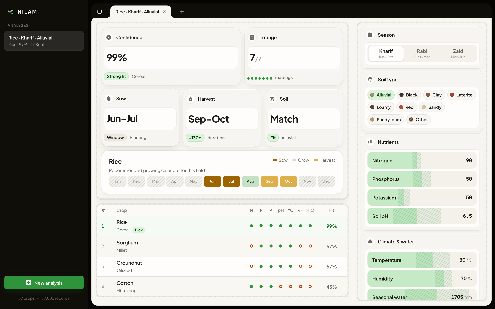

# AgroMind

**District-level crop recommendation for India**: pick a state, district and season, and get the district's crops ranked by expected relative yield, with a 90 % conformal shortlist and expected yields. Learned from 26 years of official Government of India crop statistics.

<p align="center">
  
</p>

<p align="center">
  
  
  
  
  
</p>

---

## Overview

AgroMind recommends crops for a **real Indian district and season**. The data are
**4,00,379 official district-wise crop records** from the Government of India's Directorate of
Economics & Statistics (APY reports, data.desagri.gov.in, crop years 1997-98 to 2022-23, 37 states/UTs,
748 districts). Each record is joined with NASA POWER season climate and ISRIC SoilGrids soil at the
district centroid.

The served model, **AgroMind v4 (final)**, has two parts:
- **YieldRank** ranks the crops a district actually grows by their expected relative yield next season. It blends an
  XGBoost listwise ranker, a LightGBM yield regressor and last-year persistence, using climate, soil and the district's
  own crop history.
- **A 90 % conformal set** is a short list, calibrated state by state, that contains the best-yielding crop about 90 %
  of the time.

Every crop comes with its expected and historical yield in that district.

Paper results (`docs/research/results.json` → `v4`). hit@1 = the top-ranked crop is the best-yielding one:

| Protocol | YieldRank hit@1 | Best classifier baseline | 90 % set coverage / mean size |
|----------|-----------------|--------------------------|-------------------------------|
| Unseen states | **56.3 %** | 38.3 % (MLP) | 94.2 % / 3.66 crops |
| Future years | **58.8 %** | 52.0 % (XGBoost) | 93.8 % / 3.40 crops |
| Random 5-fold | **60.0 %** | 57.5 % (Random Forest) | 93.3 % / 3.21 crops |

**Docs:** [Project documentation](docs/PROJECT.md) · [Dataset](docs/research/DATASET.md) · [Data provenance](docs/research/DATA_PROVENANCE.md) · [UI design system](frontend/DESIGN.md)

| Layer | Stack |
|-------|--------|
| Frontend | React 18, Vite |
| Backend | FastAPI, LightGBM, scikit-learn, pandas, pyarrow |
| Model | AgroMind v4 final: `experiments/final_model.py`, served by `backend/app/v4_service.py` (artifact `backend/models/v4_final.joblib`) |
| Data | `backend/data/large/agromind_india_large.parquet` (DES APY × NASA POWER × SoilGrids) |

> **Note:** the ranking is by *relative yield* (a crop's yield percentile among the districts growing it),
> over crops the district already grows. It is not profit, price or agronomy advice. Treat outputs as a
> demonstration for education.

### Research history: v1 → v2 → v3 → v4

| Version | Data | Result |
|---------|------|--------|
| v1 | Kaggle `Crop_recommendation.csv` (2,200 rows, 22 crops) | 98 % reported, but the one-vs-rest decoding was flawed and a min–max lookup already gets 88 % on that set |
| v2 | 3 merged CSVs (67,200 rows, 74 crops) | 94.3 % in random 5-fold CV, but only 7–13 % on a source held out, because the sources disagree. Retired |
| v3 | official DES APY + climate (4,00,379 rows) | ExtraTrees top-3 classifier: unseen districts hit@1 72.66 % vs 61.69 % popularity baseline. Now only the `/predict` fallback for 65 of 2,654 district-seasons with no yield records |
| **v4 (live)** | same + soil + district crop history | YieldRank + conformal sets, the results above |

All of it is reproducible in Colab: `notebooks/AgroMind_v2_Research.ipynb` (v1 → v2),
`notebooks/AgroMind_v3_LargeScale.ipynb` (v3) and `notebooks/AgroMind_v4_Novel_Method.ipynb` (v4).
Numbers are in `docs/research/results.json`.

---

## Quick start

### Prerequisites

- Python **3.10+**
- Node.js **18+** and npm

### Windows — one click

```bat
start_all.bat
```

This opens the backend and frontend in separate terminals. The first run creates `backend/.venv` and
installs dependencies. The API loads the trained v4 model (`backend/models/v4_final.joblib`, committed) at startup in about a second.

Then open **http://127.0.0.1:5173**

### Manual

```bash
# backend
cd backend
python -m venv .venv
source .venv/bin/activate         # Windows: .venv\Scripts\activate
pip install -r requirements.txt
uvicorn app.main:app --reload --host 127.0.0.1 --port 8000

# frontend (second terminal)
cd frontend
npm install
npm run dev
```

| URL | Purpose |
|-----|---------|
| http://127.0.0.1:8000/docs | Swagger |
| http://127.0.0.1:8000/options | States → districts → seasons, crop list |
| http://127.0.0.1:8000/model-info | Model, data coverage, grouped metrics, v1/v2 history |
| http://127.0.0.1:8000/dataset | Paginated browse of all 4,00,379 rows |

Checks:

```bash
cd backend
python -m pytest tests -q     # every endpoint
OMP_NUM_THREADS=4 python train_model.py   # rebuilds the v4 artifact (a few minutes), prints its calibration
```

---

## API example

`POST /predict`: `temperature`, `humidity` and `rainfall` are optional overrides of the district's
season averages (`GET /district` returns the defaults).

```json
{ "state": "Punjab", "district": "Ludhiana", "season": "rabi" }
```

The response lists the crops Ludhiana grows in rabi, ranked by YieldRank: wheat first (probability
0.53), then sunflower, barley, mustard, green gram and peas. The 90 % set is {wheat, sunflower, barley, mustard}. Each crop has its
expected and historical median yield (t/ha), years grown and a cold-start flag. Full shapes:
[docs/PROJECT.md §5](docs/PROJECT.md#5-api).

---

## Repository layout

```text
agromind/
├── backend/
│   ├── app/
│   │   ├── main.py           # FastAPI routes
│   │   ├── v4_service.py     # serves AgroMind v4 (experiments/final_model.py) on /predict
│   │   ├── v3_service.py     # data lookups (/options, /district, /dataset) + v3 fallback model
│   │   ├── schemas.py        # /predict request model
│   │   ├── india_ref.py      # crop names, types, curated calendars
│   │   └── data_loader.py    # v2 CSV merge (used by the v2 research notebook only)
│   ├── data/large/           # DES APY × NASA POWER × SoilGrids table (+ build stats)
│   ├── data/*.csv            # v1/v2 research CSVs
│   ├── scripts/build_large_dataset.py
│   ├── models/               # v4_final.{joblib,json}: trained v4 artifact + data stamp
│   ├── tests/test_api.py
│   └── train_model.py
├── frontend/                 # React UI (see DESIGN.md)
├── notebooks/                # v1 (original), v2 research, v3 large-scale, v4 method
├── docs/
│   ├── PROJECT.md
│   └── research/             # DATASET, DATA_PROVENANCE, LITERATURE, results.json, figures
├── start_all.bat
├── start_backend.bat
└── start_frontend.bat
```

---

## Team

Final-year project, B.Tech in Computer Science and Engineering (Semester VII, academic session 2026–27),
Department of Computer Science and Engineering, Harcourt Butler Technical University (HBTU), Kanpur.

| Name | Roll no. |
|------|----------|
| Rajat Patel | 230104046 |
| Harshit Jain | 230104023 |
| Sanyam Jain | 230104055 |
| Ravi Pratap Singh | 230104047 |

**Supervisor:** Dr. Imran Khan, Assistant Professor & Project Supervisor, Department of CSE, HBTU Kanpur.

**Contact:** Ravi Pratap Singh, 230104047@hbtu.ac.in

This is an academic project. It is not an official Government of India service.

---

## License & attribution

Application code is for education and demonstration.

Crop statistics: Government of India, Directorate of Economics & Statistics (DES), under the DES copyright policy (reproduction free of charge after taking permission; see provenance). Climate: NASA POWER. Soil: ISRIC SoilGrids 2.0 (CC BY 4.0). Details and citations: [DATA_PROVENANCE.md](docs/research/DATA_PROVENANCE.md). Treat outputs as illustrative.
